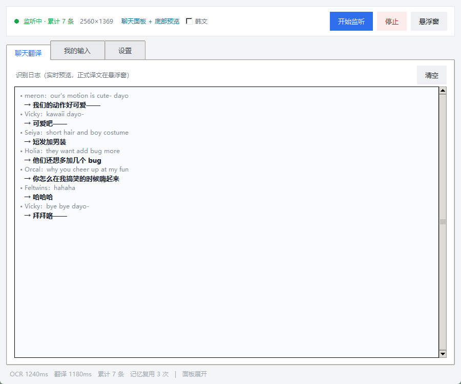
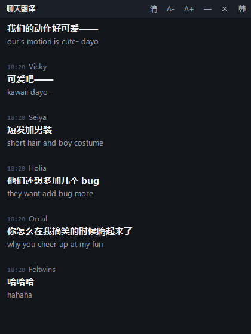
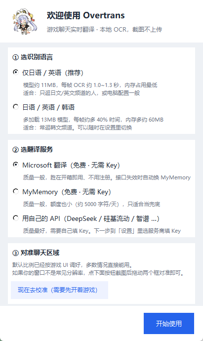
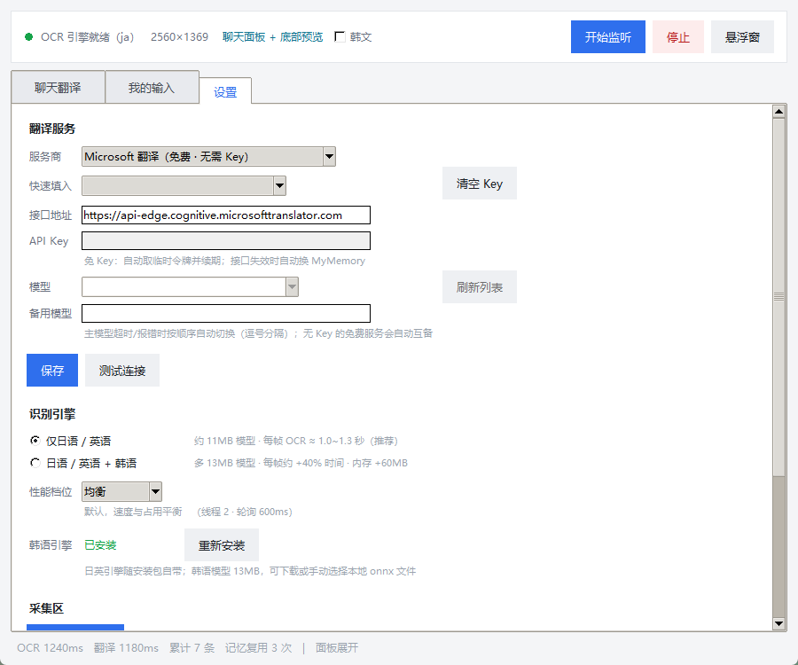

<div align="center">


# Overtrans

**用于 OverField 快速识别翻译与回复的小工具，更好地和你的国际小朋友交流**

[](LICENSE)
[](#)
[](https://www.python.org/)


</div>

---

## 这是什么

在游戏里逛国际服，聊天框刷得飞快、语言还各不相同。Overtrans 盯住聊天区域，**用本地 OCR 把文字认出来**，
再交给翻译接口，最后把中文丢进一个能挂在游戏旁边的悬浮窗。截图不上传、不注入游戏、不改游戏文件。

- **只读屏幕**：靠截图 + 离线识别，不碰游戏内存，不怕被判定异常
- **开箱即用**：解压双击就能跑，不用装 Python、不用配环境
- **免 Key 可用**：内置免费翻译通道，失效自动换下一个
- **省资源**：画面不动就不识别；同一块反复识别没有新内容会自动降频

## 界面

主界面：左边实时日志（原文 + 译文），右边一键开始监听。



悬浮窗：置顶半透明，贴在游戏边上，译文加粗、原文小字。

<p align="center"></p>

首次启动引导：选识别语言 → 选翻译服务 → 拖框对准聊天区域。

<p align="center"></p>

设置页：翻译服务、识别引擎、性能档位、采集区校准。



## 功能

| | |
|---|---|
| **双采集区** | 同时盯「聊天面板」和「底部滚动预览」；面板收起（行动/战斗模式）自动切到下面那条 |
| **滚动去重** | 上下翻历史再滚回来不会重复翻译，带本地翻译记忆 |
| **表情/贴纸归一** | 同一张贴纸被 OCR 切成几种花样也只算一条，不刷屏 |
| **半透明面板适配** | 能区分「气泡里的字」和「背后场景透进来的字」，不会把路人 ID 当发言 |
| **自适应降频** | 表情动画在动但内容没变 → 自动抬高阈值，不再对着同一张图反复 OCR |
| **韩语按需** | 韩语模型可后装，开关打开才加载（省 40% 时间 / 60MB 内存） |
| **性能档位** | 省电 / 均衡 / 精准，老机器选省电 |
| **区域可校准** | 截图后拖动两个框，点「保存并测试」直接告诉你认到几行 |

## 快速开始

1. 到 [Releases](../../releases) 下载 `Overtrans-1.0.0-win64.zip`
2. 解压到任意目录（别放 `C:\Program Files`，程序要写配置和日志）
3. 双击 `Overtrans.exe`
4. 先开游戏，再点「开始监听」，然后点「悬浮窗」把它拖到游戏旁边

> 需要 Windows 10/11 64 位，不需要安装任何运行库。

## 翻译服务怎么选

程序不绑定任何服务商，设置页里随时切换：

| 服务 | 费用 | 说明 |
|---|---|---|
| Microsoft 翻译 | 免费 | 无需注册，走 Edge 的免 Key 接口；质量一般，失效自动切下一个 |
| MyMemory | 免费 | 无需注册，按 IP 限流（约 5000 字符/天）；质量一般，当兜底 |
| Google 翻译 | 免费 | 无需 Key，但国内直连基本不通，需要系统代理 |
| DeepSeek / 硅基流动 / 智谱 / Kimi / 通义 / OpenRouter | 有免费额度 | 质量最好，需要自己填 Key；设置里「快速填入」有预设 |
| 本地 Ollama / LM Studio | 免费 | 零成本零隐私风险，需要本机跑模型 |

**建议**：长期用就注册一个智谱（`glm-4-flash` 免费）或硅基流动，质量比免 Key 通道好一大截。

## 常见问题

**识别不到字**
设置 → 采集区 → 重新框选位置。截图后拖动两个框对准聊天文字，点「保存并测试识别」，它会直接报「认到 N 行 / M 条」。如果 0 行，多半是框错位置或游戏被遮挡。

**译文质量差**
免费通道就这水平，换自己的 API。

**韩文不显示**
默认关闭。点顶部「韩文」；没装韩语模型会提示你去设置里安装（或把 `korean_PP-OCRv5_rec_mobile.onnx` 放进 `runtime/models/`）。

**杀软报毒 / 未知发布者**
PyInstaller 打包的程序常被误报，加白名单即可。要彻底消掉提示需要代码签名，流程见 [signing/README.md](signing/README.md)。

**能不能自动回复**
目前不做。游戏内自动发言大概率违反用户协议，也容易误发。输入框那一页是「翻译我要说的话」，复制粘贴自己发。

## 从源码运行

```bash
pip install -r requirements.txt
python main.py            # 直接跑

build.bat                 # 打包 → dist\Overtrans\ + release\Overtrans-win64.zip
```

推 `v1.0.0` 这种 tag 到 GitHub，Actions 会自动构建并发到 Releases（见 `.github/workflows/build.yml`）。

## 目录结构

```
Overtrans.exe            主程序
logs/                    按天日志 + 崩溃日志
config.json              配置（首次保存时生成）
runtime/                 运行库与资源，别动
  ├── models/            OCR 模型（可替换、可补装）
  ├── assets/            图标
  └── ...
```

## 许可

[MIT](LICENSE)。分发包内第三方组件的许可见 [THIRD_PARTY_NOTICES.md](THIRD_PARTY_NOTICES.md)。

本项目与 OverField 官方无关，仅读取屏幕画面，不修改游戏文件、不注入进程。
